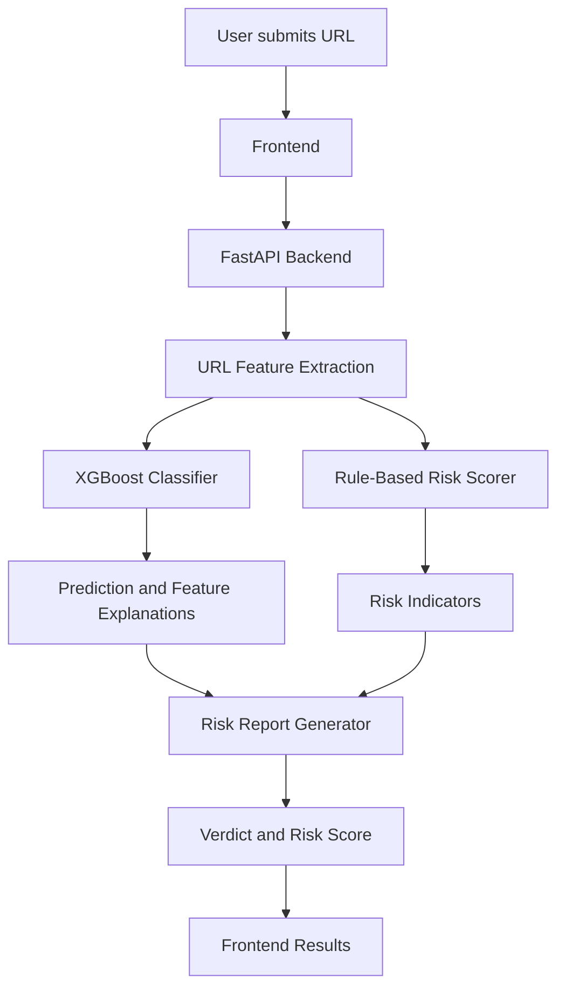
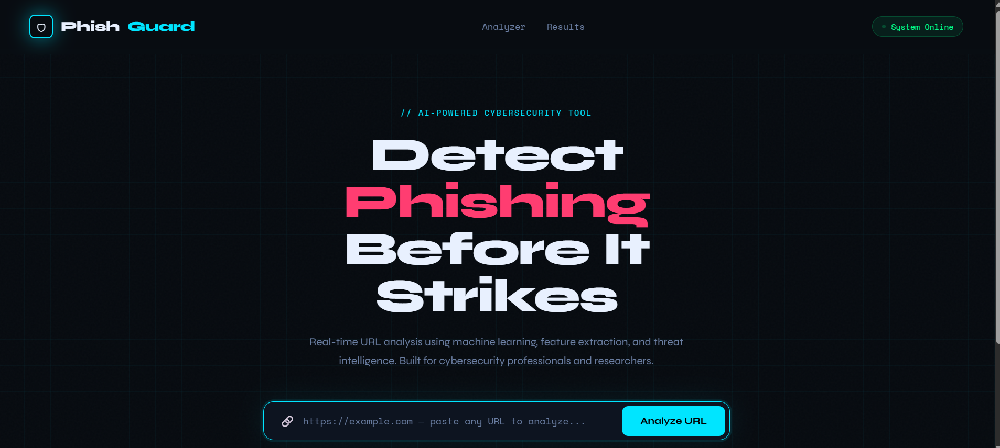
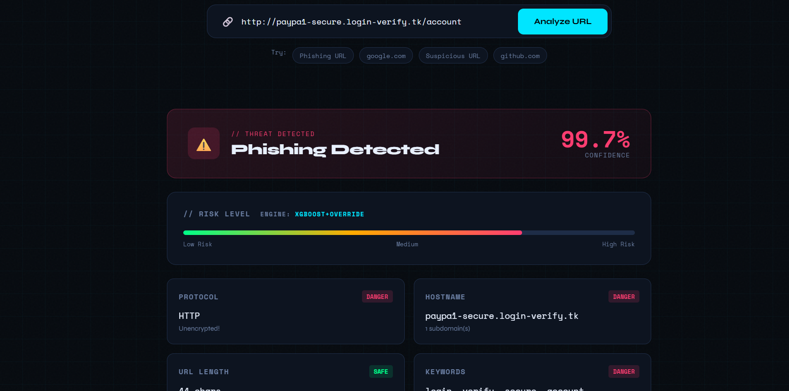
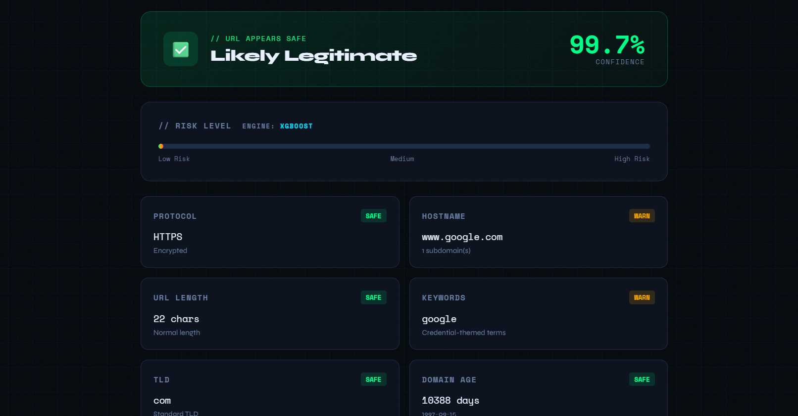

# 🛡️ PhishGuard | AI-Powered Phishing Detection

An AI-powered phishing URL detection system that combines machine learning, explainable predictions, and rule-based risk analysis to identify potentially malicious URLs.

<p align="center">
  <strong>48-Hour Online Hackathon</strong><br>
  Sai Vidya Institute of Technology · Information Science & Engineering
</p>

<p align="center">
  <a href="https://phishgaurd-pi.vercel.app">
    
  </a>
  <a href="https://phishguardd.onrender.com/docs">
    
  </a>
  <a href="https://phishguardd.onrender.com/api/v1/health">
    
  </a>
</p>

<p align="center">
  
  
  
  
  
</p>

---

## 📌 Table of Contents

- [Overview](#-overview)
- [Problem Statement](#-problem-statement)
- [Our Approach](#-our-approach)
- [Key Features](#-key-features)
- [System Workflow](#-system-workflow)
- [Screenshots](#-screenshots)
- [Machine Learning Model](#-machine-learning-model)
- [Risk Scoring](#-risk-scoring)
- [Technology Stack](#-technology-stack)
- [Project Structure](#-project-structure)
- [Getting Started](#-getting-started)
- [API Reference](#-api-reference)
- [Deployment](#-deployment)
- [Limitations](#-limitations)
- [Future Enhancements](#-future-enhancements)
- [Team](#-team)
- [References](#-references)

---

## 🎯 Overview

PhishGuard is an AI-powered phishing detection system designed to analyze URLs and identify suspicious patterns that may indicate phishing attempts.

Instead of relying exclusively on known malicious URL lists, the system evaluates URL characteristics using a machine learning model and a rule-based scoring engine. It also provides explanations to help users understand why a URL was flagged.

**Project objective:** Detect potentially malicious URLs, communicate their risk clearly, and make phishing detection more transparent.

## 🚨 Problem Statement

Phishing attacks use deceptive URLs and fake websites to trick users into revealing credentials, financial information, and other sensitive data.

Traditional blacklist-based approaches can struggle with newly created phishing URLs that have not yet been reported.

PhishGuard explores a complementary approach: analyzing URL characteristics and suspicious patterns to identify potentially malicious links, including URLs that may not appear on existing blocklists.

## 💡 Our Approach

The system combines machine learning with interpretable risk analysis.

### System workflow

1. **URL input:** The user submits a URL through the web interface.
2. **Feature extraction:** The backend extracts 22 structural and behavioral URL features without intentionally loading the target webpage during extraction.
3. **ML classification:** An XGBoost model estimates whether the URL resembles phishing activity.
4. **Rule-based analysis:** A heuristic scoring engine evaluates additional suspicious indicators.
5. **Explainability:** SHAP-based explanations identify influential model features, where supported by the implementation.
6. **Risk report:** The interface presents a verdict, confidence information, risk score, and relevant warning flags.

### Why PhishGuard?

- **Pattern-based detection:** Evaluates URL characteristics rather than depending solely on known malicious URL lists.
- **Explainable results:** Helps users understand which signals contributed to a prediction.
- **Combined analysis:** Brings machine learning and rule-based heuristics together.
- **Web-based interface:** Makes URL analysis accessible through a browser.
- **Deployable architecture:** Separates the frontend from the FastAPI backend.

> Note: Machine learning predictions are not a guarantee that a URL is safe or malicious. Treat results as a risk assessment rather than definitive proof.

---

## ✨ Key Features

| Feature | Description |
|---|---|
| URL analysis | Accepts URLs for phishing risk assessment |
| Feature extraction | Examines structural and selected behavioral indicators |
| ML classification | Uses an XGBoost-based classification pipeline |
| Risk scoring | Combines model output with heuristic signals |
| Explainability | Uses SHAP-based feature attribution, where available |
| Warning flags | Highlights suspicious URL characteristics |
| REST API | Exposes URL analysis and health-check endpoints |
| Web deployment | Frontend hosted on Vercel and backend on Render |

## 🔄 System Workflow



---

## 📸 Screenshots

Add the following screenshots to the `screenshots/` directory in this repository.

### Homepage — URL Analyzer



### Phishing Detection Result



### Safe URL Result



---

## 🧠 Machine Learning Model

The project uses an XGBoost-based classifier alongside a rule-based scoring engine.

| Property | Details |
|---|---|
| Primary algorithm | XGBoost |
| Fallback | GradientBoostingClassifier, if implemented and activated |
| Training samples | 20,000, as reported for the project |
| Extracted features | 22 URL features |
| Explainability | SHAP |
| Evaluation | AUC-ROC; report the verified test result |

### Model considerations

- Feature extraction focuses on URL characteristics and selected domain or network indicators.
- The classifier estimates phishing likelihood from learned patterns.
- SHAP explanations help identify features influencing individual predictions.
- The reported dataset composition and performance must be validated against the actual training and evaluation pipeline.

---

## 📊 Risk Scoring

The system groups suspicious indicators into four categories.

| Category | Maximum score | Example signals |
|---|---:|---|
| URL Structure | 40 | URL length, hyphens, IP addresses, subdomains, encoding |
| Domain Intelligence | 35 | TLD risk, brand impersonation, domain age, where available |
| Content Analysis | 15 | Suspicious keywords and URL entropy |
| Behavioral Signals | 10 | DNS resolution and port-related anomalies |

**Reported scoring formula:**

`Final risk score = (ML probability × 60) + (rule score × 0.4)`

Ensure the implementation normalizes both inputs to compatible scales and produces the intended final range before publishing this formula.

---

## 🧰 Technology Stack

| Layer | Technology |
|---|---|
| Frontend | HTML, CSS, JavaScript |
| Backend | Python, FastAPI |
| Machine Learning | XGBoost, scikit-learn |
| Explainable AI | SHAP |
| Domain Intelligence | python-whois, socket/DNS |
| Frontend Hosting | Vercel |
| Backend Hosting | Render |
| Version Control | Git, GitHub |

---

## 📁 Project Structure

```text
phishguard/
├── PHISHGAURD.html
├── requirements.txt
├── Procfile
├── render.yaml
├── vercel.json
├── README.md
├── app/
│   ├── __init__.py
│   ├── main.py
│   ├── features.py
│   ├── scorer.py
│   └── train_model.py
├── screenshots/
│   ├── homepage.png
│   ├── phishing-result.png
│   └── safe-result.png
└── phishguard/
    ├── manifest.json
    ├── background.js
    ├── content.js
    ├── popup.html
    └── icons/
```

*The tree reflects the supplied project layout. Verify file and directory names against your actual repository.*

---

## 🚀 Getting Started

### Prerequisites

- Python 3.10 or above
- pip
- Git

### 1. Clone the repository

```bash
git clone https://github.com/akshithaaballal/phishguard.git
cd phishguard
```

### 2. Install dependencies

```bash
pip install -r requirements.txt
```

### 3. Train the model

```bash
python -m app.train_model
```

This runs the project's model-training pipeline. Dataset generation, training duration, and output location depend on the implementation.

### 4. Start the backend

```bash
uvicorn app.main:app --reload --port 8000
```

### 5. Open the frontend

Open `PHISHGAURD.html` in your browser if it is designed to run directly from a local file.

The frontend must be configured to use `http://localhost:8000` for local analysis. If browser restrictions or API configuration prevent requests from a local file, serve the frontend through a local HTTP server instead.

### 6. Explore the API

Once the backend is running, visit:

- Swagger documentation: `http://localhost:8000/docs`
- Health endpoint: `http://localhost:8000/api/v1/health`

---

## 🔌 API Reference

### `POST /api/v1/analyze`

Submits a URL for phishing risk analysis.

**Example request**

```json
{
  "url": "http://example.com"
}
```

**Illustrative response schema**

```json
{
  "verdict": "PHISHING",
  "confidence": 0.947,
  "risk_score": 87,
  "engine": "xgboost",
  "breakdown": {
    "url_score": 22,
    "domain_score": 27,
    "content_score": 12,
    "behavioral_score": 5
  },
  "flags": [],
  "shap_values": {},
  "extraction_time_ms": 184
}
```

The values above illustrate the response format, not a verified prediction for the example URL. Actual fields and value ranges depend on the backend implementation.

### `GET /api/v1/health`

Checks backend availability and, if exposed by the application, model-loading status.

---

## 🌐 Deployment

| Service | URL |
|---|---|
| Live Frontend | [phishgaurd-pi.vercel.app](https://phishgaurd-pi.vercel.app) |
| Backend | [phishguardd.onrender.com](https://phishguardd.onrender.com) |
| API Health | [Health Check](https://phishguardd.onrender.com/api/v1/health) |
| Swagger API Docs | [Interactive API Documentation](https://phishguardd.onrender.com/docs) |

The backend uses Render hosting and may experience cold starts when inactive, depending on the current service plan.

---

## ⚠️ Known Limitations

- **Training data:** The reported dataset includes synthetic samples. Performance on real-world phishing campaigns may differ.
- **Domain intelligence:** WHOIS information may be unavailable, incomplete, or privacy-protected.
- **Detection limitations:** New attack patterns and carefully crafted URLs can evade classification.
- **Hosting latency:** Backend response time can vary with hosting conditions.
- **Scope:** The current system focuses on URLs; full email-body analysis is not included unless implemented separately.
- **External signals:** DNS and domain-based checks may fail or return incomplete information.

---

## 🔭 Future Enhancements

- Integrate Google Safe Browsing and VirusTotal for additional threat intelligence.
- Add email-body and suspicious-link analysis.
- Evaluate the model on larger, real-world datasets.
- Add user feedback and model monitoring.
- Develop a browser extension for warning users about suspicious links.
- Improve testing, calibration, and robustness against previously unseen phishing campaigns.

---

## 👥 Team

Built during the 48-hour online hackathon at Sai Vidya Institute of Technology.

| Team member | Student ID |
|---|---|
| Akshithaa Ballal | 1VA23IS006 |
| Akarsh Sujay Kumar | 1VA23IS004 |
| Ananya R | 1VA23IS009 |
| Devraj M P | 1VA23IS022 |

**Institution:** Sai Vidya Institute of Technology  
**Department:** Information Science & Engineering  
**Semester:** 6th Semester

---

## 📚 References

1. Mohammad, R. M., et al. (2016). UCI Machine Learning Repository: Phishing Websites Dataset.
2. Sahingoz, O. K., et al. (2019). Machine learning based phishing detection from URLs. *Expert Systems with Applications*.
3. Anti-Phishing Working Group (APWG). eCrime Reports.
4. Spamhaus. Domain reputation and threat intelligence resources.

---

<p align="center">
  <strong>PhishGuard</strong><br>
  Building safer browsing through explainable phishing detection.
</p>
